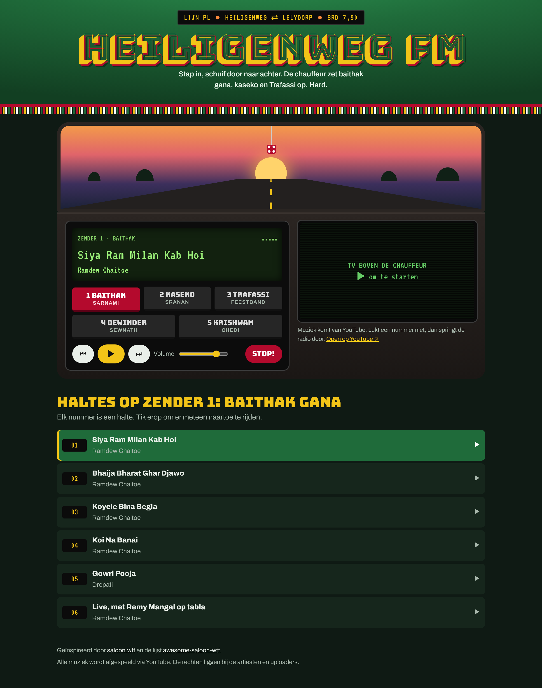

# Heiligenweg FM

Een nostalgische muzieksite van **Rawien Paltoe**: je zit voorin een Surinaamse lijnbus van Heiligenweg naar Lelydorp, en de chauffeur draait baithak gana, kaseko en Trafassi.

- Eén bestand: `index.html` (geen build nodig)
- Muziek via YouTube-embeds. Een nummer dat niet ingesloten mag worden, wordt automatisch overgeslagen.
- Nummers aanpassen: bewerk de lijst `STATIONS` onderaan in `index.html` (YouTube-video-ID, titel, artiest).

## Online zetten met GitHub Pages
1. Push deze map naar een GitHub-repo.
2. Ga naar Settings → Pages → Source: *Deploy from a branch*, kies `main` en `/ (root)`.

## Screenshots

## Beheer
Zenders, muziek en teksten pas je aan op **/beheer/** (bijvoorbeeld `https://rawien0812.github.io/heiligenweg-fm/beheer/`).
Alles staat in `zenders.json`; de beheerpagina slaat wijzigingen via de GitHub-API op in deze repo, waarna de site vanzelf opnieuw online gaat.
Inloggen gaat met een fine-grained GitHub-token met alleen toegang tot deze repo (Contents: Read and write).
